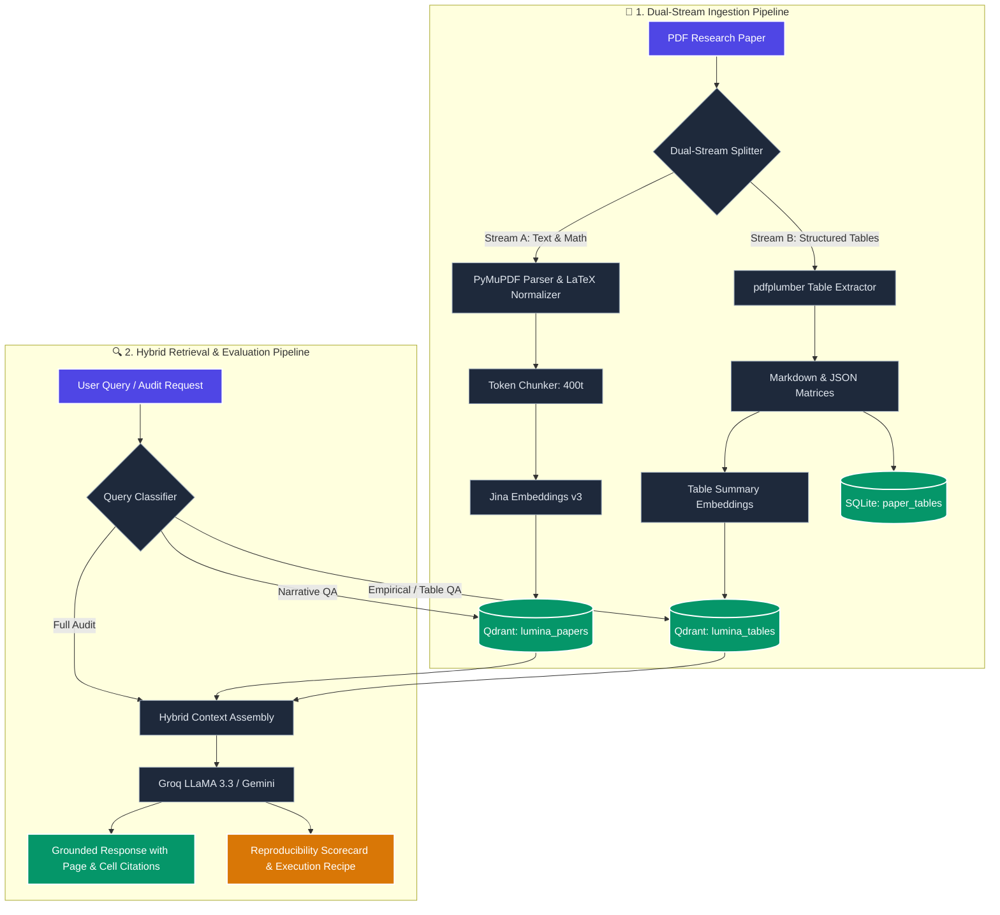

# 💡 Lumina AI (v2.5)

> **A grounded, zero-hallucination AI research & evaluation engine.**  
> Upload scientific PDFs, query with page- and cell-level citations, extract structured tables and LaTeX equations with **TeX-RAG**, generate 8 summary styles, create active-recall study sets, compare multiple papers, spot hidden research gaps, and automatically audit papers for **methodological reproducibility and data leakage**.

[](https://www.python.org/)
[](https://fastapi.tiangolo.com/)
[](https://qdrant.tech/)
[](#-running-tests)
[](#-step-2-get-your-free-api-keys)
[](LICENSE)

---

## 🌟 What is Lumina AI?

Reading and evaluating complex scientific papers is time-consuming and fraught with challenges:
- Generic AI chatbots hallucinate findings, invent plausible citations, and struggle with technical depth.
- Traditional RAG assistants flatten 2D benchmark tables into unreadable text noise and mutilate mathematical symbols.
- Over 60% of published machine learning and biomedical papers suffer from the **Replication Crisis**—omitting random seeds, learning rates, compute footprints, or train/test leakage hygiene.

**Lumina AI** solves these challenges using a **multimodal, verification-first scientific intelligence pipeline**:

1. **Dual-Stream TeX-RAG (Multimodal Table & Equation Engine)**:
   - **Stream A (Text & Math)**: Extracts narrative sections while normalizing mathematical notation into standard LaTeX blocks (`$$...$$`), rendered live via KaTeX.
   - **Stream B (Structured Tables)**: Uses layout-aware table extraction (`pdfplumber`) to preserve tabular matrices as Markdown and JSON schemas in a dedicated Qdrant collection (`lumina_tables`).
   - **Cell-Level Grounding**: Answers empirical questions with exact cell citations (e.g. *Table 2, Row "Ours", Column "F1 Score"*).

2. **Automated Reproducibility & Leakage Audit Engine**:
   - Evaluates papers across a **5-dimensional scientific rubric**: Hyperparameter Completeness Index (HCI), Compute Footprint, Dataset Hygiene & Leakage Risk, Statistical Rigor & Variance, and Code/Artifact Availability.
   - Calculates a normalized **Auto-Repro Score (0–100%)** and an academic letter grade (**A+ to F**).
   - Synthesizes an actionable, copyable **Reproduction Recipe** (CLI commands, hardware estimates, missing hyperparameter warnings).
   - Generates a downloadable **Peer-Reviewer Scorecard** (`.md`) ready for conference review forms.

3. **Grounded Academic Assistant**:
   - Zero-hallucination constraint: strictly answers from context with clickable page citations `[1][2]`; responds *"I don't know"* if unsupported.
   - 8 summary styles, interactive active-recall quizzes (MCQ, True/False, Short Answer), flip flashcards, multi-paper comparative analysis, and research gap detection.

4. **100% Free-Tier Architecture**: Built to run entirely on generous free tiers — **Groq** (Llama 3.3 70B) or **Google Gemini**, **Jina AI v3** embeddings, and **Qdrant** (local or cloud). Full observability via **Langfuse**.

---

## ✨ Key Features

| Feature | Description |
|---|---|
| 🔬 **Reproducibility Audit Engine** | Audits papers across 5 dimensions (hyperparameters, compute, dataset hygiene, variance, code availability), assigning an instant letter grade (A+ to F) and generating a runnable reproduction blueprint. |
| 📊 **Dual-Stream TeX-RAG** | Ingests tables into structured Markdown/JSON in a dedicated vector collection and preserves LaTeX equations with live KaTeX rendering. |
| 💬 **Grounded Q&A & Streaming** | Chat with individual papers or your entire library. Supports real-time Server-Sent Events (SSE) streaming with page and table cell badges. |
| 📑 **8 Summary Modes** | Choose from: **Abstract**, **Methodology**, **Results**, **Conclusion**, **Beginner (ELI5)**, **Technical**, **Bullet Points**, or **One-Page Executive Brief**. |
| 🎓 **Interactive Quizzes** | Test comprehension with auto-generated **Multiple Choice**, **True/False**, or **Short Answer** questions with instant scoring and explanations. |
| 🗂️ **Active-Recall Flashcards** | Digital flip cards generated directly from paper concepts for exam revision and literature review. |
| 🔭 **Research Gap Detector** | Analyzes papers to uncover unaddressed limitations, hidden assumptions, open problems, and promising future research ideas. |
| ⚖️ **Paper Comparison** | Select 2+ papers for a side-by-side comparative matrix of problem statements, methods, datasets, and benchmark results. |
| 📋 **Peer-Reviewer Export** | One-click export of the full reproducibility audit as a standardized conference review scorecard (`.md`). |
| 🎨 **Modern Glassmorphic UI** | Responsive dark-mode dashboard with circular SVG score meters, KaTeX math rendering, table modals, library manager, and activity logs. |
| 🔭 **Full Observability** | Native integration with **Langfuse Cloud** for inspecting retrieval relevance scores, token usage, latency, and prompt traces. |
| 🔒 **Access Gatekeeper** | Optional password protection (`ACCESS_CODE`) to secure hosted instances. |

---

## 🧠 System Architecture



---

## 🚀 Quickstart Guide

Get Lumina AI up and running locally in under 5 minutes.

### 📋 Prerequisites

1. **Python 3.11 or newer** ([Download Python](https://www.python.org/downloads/))
2. **Git** ([Download Git](https://git-scm.com/))
3. **Docker Desktop** (for running local Qdrant; or use free [Qdrant Cloud](#-alternative-running-without-local-docker))

---

### Step 1: Clone the Repository

```bash
git clone https://github.com/bandarilokesh/luminaai.git
cd luminaai
```

---

### Step 2: Get Your Free API Keys

You only need **two free keys** to get started:

1. **LLM Provider (Choose one)**:
   - **Groq** *(Recommended — blazing fast)*: Free key at [console.groq.com/keys](https://console.groq.com/keys).
   - **Google Gemini**: Free key at [aistudio.google.com/apikey](https://aistudio.google.com/apikey).

2. **Embeddings**:
   - **Jina AI**: Free key (1M free tokens) at [jina.ai/embeddings](https://jina.ai/embeddings).

3. *(Optional)* **Observability**:
   - **Langfuse Cloud**: Free project at [cloud.langfuse.com](https://cloud.langfuse.com).

---

### Step 3: Create Your `.env` File

Copy the template file to create your active configuration:

```bash
# Windows (PowerShell / CMD)
copy .env.example .env

# macOS / Linux
cp .env.example .env
```

Open `.env` and fill in your keys:

```ini
# Choose your LLM: "groq" or "gemini"
LLM_PROVIDER=groq
GROQ_API_KEY=gsk_your_groq_api_key_here
GROQ_MODEL=llama-3.3-70b-versatile

# If using Gemini:
# LLM_PROVIDER=gemini
# GEMINI_API_KEY=your_gemini_api_key_here
# GEMINI_MODEL=gemini-flash-lite-latest

# Embeddings API Key (Required)
JINA_API_KEY=jina_your_jina_api_key_here

# Local Vector Database (Qdrant)
QDRANT_URL=http://localhost:6333
```

---

### Step 4: Start the Qdrant Vector Database

```bash
docker compose up -d qdrant
```

> 💡 **Tip**: Access the visual Qdrant dashboard anytime at [http://localhost:6333/dashboard](http://localhost:6333/dashboard).

---

### Step 5: Install Dependencies & Run

```bash
# 1. Create and activate a virtual environment
python -m venv .venv

# Windows:
.venv\Scripts\activate
# macOS / Linux:
source .venv/bin/activate

# 2. Install dependencies
pip install -r requirements.txt

# 3. Start the application
uvicorn app.main:app --port 8000 --reload
```

---

### Step 6: Open the App

Open your browser and navigate to:  
👉 **[http://localhost:8000](http://localhost:8000)**

1. Go to the **Upload** tab and drop in any research PDF (e.g. from arXiv).
2. Watch both narrative text and structured tables get indexed.
3. Switch to **QA**, **Reproducibility**, **Summary**, or **Study Tools** and start exploring!

---

## ☁️ Alternative: Running Without Local Docker

If you don't use Docker, use **Qdrant Cloud's permanent free tier**:

1. Sign up for free at [cloud.qdrant.io](https://cloud.qdrant.io).
2. Create a free 1GB cluster.
3. Paste your cluster credentials into `.env`:
   ```ini
   QDRANT_URL=https://your-cluster-id.region.gcp.cloud.qdrant.io:6333
   QDRANT_API_KEY=your_qdrant_api_key
   ```
4. Run `uvicorn app.main:app --port 8000` — no Docker needed!

---

## 🧭 Navigating the App

| Tab | Purpose |
|---|---|
| **Dashboard** | System health monitors, paper counts, query metrics, and recent activity logs. |
| **Library** | Paper manager with metadata (authors, abstract, page count, chunk count, table count). |
| **Upload** | Drag-and-drop PDF upload or batch import up to 25 papers via direct URLs. |
| **QA (Chat)** | Streaming answers with page-level citations, cell-level tabular grounding, and LaTeX formula display. Supports dedicated Table Query mode. |
| **Reproducibility** | Full 5D audit scorecard, A+ to F grade, circular score meter, hyperparameter risk breakdown, runnable reproduction recipe, and one-click reviewer export. |
| **Summary** | Generate targeted summaries in 8 distinct formats with markdown export. |
| **Study Tools** | Active recall quiz generator (MCQ, True/False, Short Answer) and interactive flashcards. |
| **Research Gaps** | Surface unaddressed limitations, hidden assumptions, and open research problems. |
| **Compare** | Compare 2+ papers side-by-side across problems, methods, datasets, and benchmark results. |
| **Settings** | Connectivity health check for Groq/Gemini, Jina AI, Qdrant, and Langfuse. |

---

## 🛠️ REST API Documentation

Interactive Swagger documentation is available at **[http://localhost:8000/docs](http://localhost:8000/docs)**.

### Papers & Ingestion
- `POST /api/papers/upload` — Upload and index a PDF (processes text, LaTeX math, and tables).
- `POST /api/papers/upload-url` — Import and index a paper directly from a URL.
- `GET /api/papers/` — List all indexed papers.
- `DELETE /api/papers/{id}` — Delete a paper and remove points from both vector collections.

### Grounded Question Answering & Tables
- `POST /api/qa` — Submit a question and receive a grounded answer with citations.
- `POST /api/qa/table` — Table-targeted QA demanding cell-level citations.
- `POST /api/qa/stream` — Real-time Server-Sent Events (SSE) streaming answers.
- `GET /api/tables/{paper_id}` — Retrieve all extracted structured tables for a paper.

### Reproducibility & Peer Review
- `GET /api/audit/{paper_id}` — Retrieve or run the 5D reproducibility audit.
- `POST /api/audit/{paper_id}/refresh` — Force a re-run of the reproducibility audit.
- `GET /api/audit/{paper_id}/export` — Download the audit report as a formatted Markdown review scorecard.

### Study Tools & Synthesis
- `POST /api/summary` — Request a summary in any of the 8 supported styles.
- `POST /api/quiz` — Generate an active recall quiz.
- `POST /api/flashcards` — Generate study flashcards.
- `POST /api/compare` — Compare two or more papers side-by-side.
- `POST /api/gap-detector` — Detect unaddressed research gaps.
- `GET /api/status` — Health status of all connected services.

---

## 🧪 Running Tests

Lumina AI includes a comprehensive test suite covering standard RAG, the dual-stream table extractor, the LaTeX normalizer, and the 5-dimension reproducibility engine.

Tests run **100% offline** using in-memory Qdrant and deterministic mocks:

```bash
pytest
```

```
============================= test session starts =============================
collected 28 items

tests/test_api.py::test_health_and_spa PASSED                            [  3%]
tests/test_api.py::test_upload_rejects_non_pdf PASSED                    [  7%]
tests/test_api.py::test_full_flow PASSED                                 [ 10%]
tests/test_api.py::test_llm_errors_become_502 PASSED                     [ 14%]
tests/test_api.py::test_access_code_gate PASSED                          [ 17%]
tests/test_novelty.py::test_extracts_ruled_and_booktabs_tables_with_captions PASSED [ 21%]
tests/test_novelty.py::test_clean_matrix_and_merged_headers PASSED       [ 25%]
tests/test_novelty.py::test_words_to_matrix_infers_columns_from_shared_whitespace PASSED [ 28%]
tests/test_novelty.py::test_math_normalizer_display_and_inline PASSED    [ 32%]
tests/test_novelty.py::test_needs_tables_routing PASSED                  [ 35%]
tests/test_novelty.py::test_tables_indexed_and_retrieved_for_tabular_questions PASSED [ 39%]
tests/test_novelty.py::test_format_context_labels_tables PASSED          [ 42%]
tests/test_novelty.py::test_scan_signals_detects_evidence PASSED         [ 46%]
tests/test_novelty.py::test_grades_and_dimension_scoring PASSED          [ 50%]
tests/test_novelty.py::test_build_report_caps_artifacts_without_repository PASSED [ 53%]
tests/test_novelty.py::test_recipe_and_reviewer_export PASSED            [ 57%]
tests/test_novelty.py::test_malformed_llm_output_degrades_gracefully PASSED [ 60%]
tests/test_novelty.py::test_tables_audit_and_table_qa_endpoints PASSED   [ 64%]
tests/test_rag.py::test_loader_extracts_metadata_and_cleans PASSED       [ 67%]
tests/test_rag.py::test_clean_page_fixes_hyphenation_and_page_numbers PASSED [ 71%]
tests/test_rag.py::test_detect_heading PASSED                            [ 75%]
tests/test_rag.py::test_recursive_chunker_respects_size_and_overlap PASSED [ 78%]
tests/test_rag.py::test_chunk_document_keeps_page_and_section PASSED     [ 82%]
tests/test_rag.py::test_vector_store_crud PASSED                         [ 85%]
tests/test_rag.py::test_answer_question_grounds_prompt_in_context PASSED [ 89%]
tests/test_rag.py::test_answer_question_without_context_says_i_dont_know PASSED [ 92%]
tests/test_rag.py::test_stream_answer_events PASSED                      [ 96%]
tests/test_rag.py::test_format_context_respects_budget PASSED            [100%]

============================= 28 passed in 6.71s ==============================
```

---

## 📁 Project Structure

```
lumina-ai/
├── app/
│   ├── config.py                 # Settings, paths, and environment variable parsing
│   ├── db.py                     # SQLite store (papers, audits, tables, history, activity)
│   ├── features.py               # Summaries, quizzes, flashcards, comparison, gaps
│   ├── logger.py                 # Colorized application logger
│   ├── main.py                   # FastAPI entrypoint, lifespan, auth gate & routing
│   ├── observability.py          # Langfuse tracing integrations
│   ├── schemas.py                # Pydantic v2 data models for API requests/responses
│   ├── rag/
│   │   ├── chunker.py            # Recursive token-aware text chunking
│   │   ├── embeddings.py         # Jina AI embedding client
│   │   ├── llm.py                # Groq & Gemini OpenAI-compatible client
│   │   ├── loader.py             # PyMuPDF text cleaner, LaTeX normalizer & metadata
│   │   ├── pipeline.py           # Core dual-stream indexing and QA answering logic
│   │   ├── prompts.py            # System prompts, templates & multimodal formatting
│   │   ├── reproducibility.py    # 5D Reproducibility & Leakage Audit Engine
│   │   ├── retriever.py          # Hybrid multimodal vector retriever
│   │   ├── table_extractor.py    # Layout-aware PDF table extraction (Markdown + JSON)
│   │   └── vector_store.py       # Qdrant client managing text and table collections
│   └── routers/
│       ├── audit.py              # Reproducibility audit, export & table endpoints
│       ├── papers.py             # Paper upload, deletion, listing, re-indexing
│       └── rag.py                # QA, table-targeted QA, summary, study tools endpoints
├── docs/
│   └── NOVELTY_IMPLEMENTATION_PLAN.md # Publication blueprint for Novelties 2 & 4
├── frontend/
│   └── static/                   # SPA frontend (HTML5, KaTeX math, Glassmorphism CSS, JS)
├── tests/
│   ├── conftest.py               # Mock fixtures for deterministic offline testing
│   ├── test_api.py               # FastAPI endpoint tests
│   ├── test_novelty.py           # Table extraction, math normalizer & audit tests
│   └── test_rag.py               # Chunker, retriever, and pipeline tests
├── docker-compose.yml            # Docker definitions for Qdrant and web app
├── Dockerfile                    # Container build configuration
├── requirements.txt              # Project dependencies (includes pdfplumber)
└── .env.example                  # Environment configuration template
```

---

## 📄 License

This project is licensed under the [MIT License](LICENSE) — feel free to use, modify, and distribute it for academic or personal projects.
