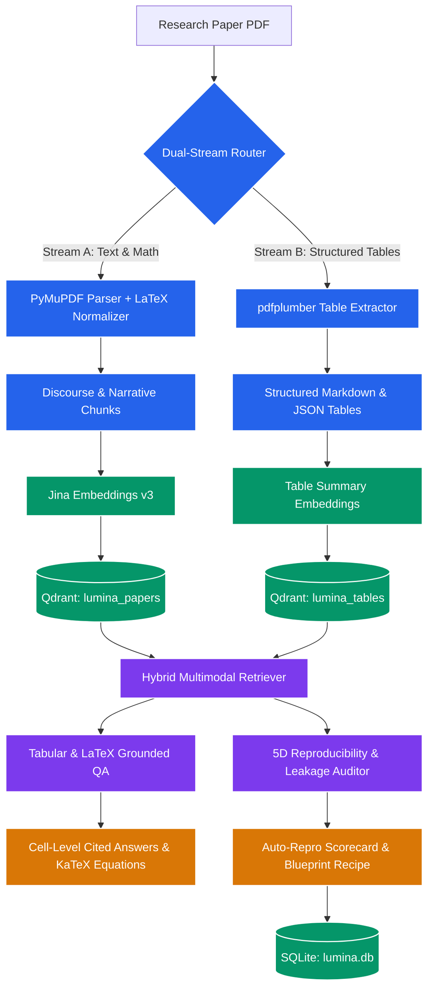
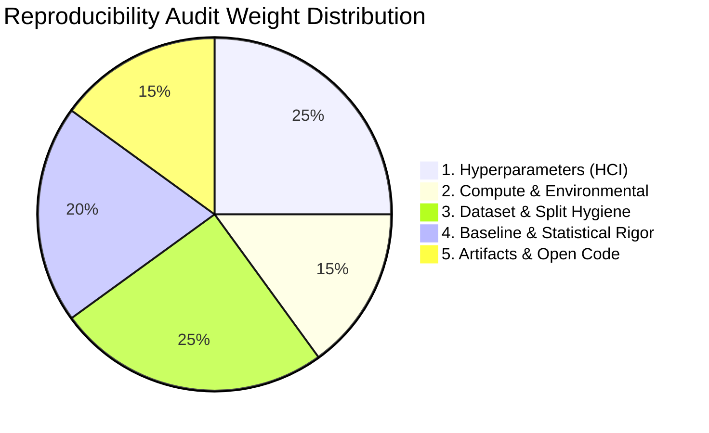
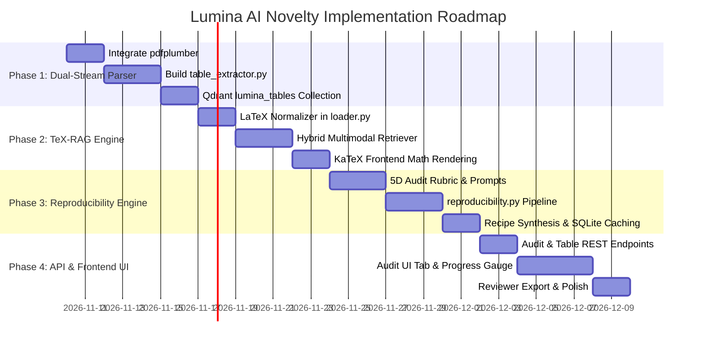

# 🔬 Lumina AI — Novelty Implementation Blueprint
## Novelty 2 (Reproducibility & Leakage Audit Engine) & Novelty 4 (Dual-Stream Multimodal Table & Equation Engine)

---

## Executive Summary & Strategic Advantage

While existing academic AI assistants (e.g., *NotebookLM*, *SciSpace/Typeset*, *Elicit*, *Consensus*, *ChatPDF*, *PaperQA 2*) focus on generic textual question answering and summarization, they suffer from two critical limitations that prevent researchers from trusting them:

1. **Tabular & Mathematical Blindness**: Scientific proofs, hyperparameters, ablation results, and benchmark leaderboards are housed within **tables and LaTeX equations**. Traditional PDF loaders flatten 2D tabular grids into unintelligible 1D string noise and corrupt mathematical notation.
2. **The Academic Replication Crisis**: Over 60% of published machine learning and scientific papers omit critical experimental parameters (random seeds, learning rate schedules, compute budget, train/test leakage hygiene). No commercial tool systematically audits a paper for reproducibility.

By implementing **Novelty 4 (Dual-Stream Table & Equation Engine)** and **Novelty 2 (Reproducibility & Leakage Audit Engine)**, Lumina AI evolves from a standard RAG chatbot into an **authoritative scientific evaluation platform**.

The synergy is structural: **Novelty 2 directly relies on Novelty 4**, because hyperparameter tables, ablation matrices, and benchmark comparisons extracted by the Table Engine provide the ground truth required by the Reproducibility Auditor.

---

## Architecture Overview



---

## 1. Novelty 4: Dual-Stream Multimodal Table & Equation Engine (TeX-RAG)

### 1.1 Technical Challenges Solved
* **Grid Scrambling**: Tables extracted via standard text extraction merge adjacent columns into single lines.
* **Equation Mutilation**: Symbols like $\nabla_\theta \mathcal{L}$, $\sum_{i=1}^N$, and matrices are converted into malformed unicode characters.
* **Cell-Level Grounding**: Citations must refer not just to "Page 6", but to **"Table 2, Row 'Ours', Column 'F1 Score'"**.

---

### 1.2 Component Design

#### A. Dependency Specification
Add `pdfplumber` to `requirements.txt`:
```txt
pdfplumber>=0.11.0
```

#### B. Table Extraction Module (`app/rag/table_extractor.py`)
This module scans each page using layout boundary analysis, separates table regions from body text, extracts headers, and constructs dual representations:
1. **Markdown Representation**: For LLM prompt context injection.
2. **JSON Matrix Representation**: For structured cell coordinate lookups and cell-level citations.

```python
"""Table Extractor: Identifies, extracts, and serializes tables from PDFs."""
from dataclasses import dataclass
from pathlib import Path
from typing import Any
import pdfplumber


@dataclass
class ExtractedTable:
    table_index: int
    page: int
    caption: str
    headers: list[str]
    rows: list[list[str]]
    markdown: str
    json_data: dict[str, Any]


def extract_tables_from_pdf(pdf_path: Path) -> list[ExtractedTable]:
    extracted: list[ExtractedTable] = []
    with pdfplumber.open(pdf_path) as pdf:
        table_counter = 0
        for page_idx, page in enumerate(pdf.pages):
            page_num = page_idx + 1
            tables = page.find_tables()
            for t in tables:
                raw_matrix = t.extract()
                if not raw_matrix or len(raw_matrix) < 2:
                    continue  # Ignore single-line noise or false positives
                
                table_counter += 1
                headers = [str(cell).strip() if cell else "" for cell in raw_matrix[0]]
                rows = [[str(cell).strip() if cell else "" for cell in row] for row in raw_matrix[1:]]

                # Generate clean Markdown table
                md_header = "| " + " | ".join(headers) + " |"
                md_divider = "| " + " | ".join(["---"] * len(headers)) + " |"
                md_rows = "\n".join("| " + " | ".join(row) + " |" for row in rows)
                markdown = f"{md_header}\n{md_divider}\n{md_rows}"

                # Extract surrounding text within 80pt vertically as caption candidate
                bbox = t.bbox  # (x0, top, x1, bottom)
                caption = f"Table {table_counter} (Page {page_num})"
                try:
                    above_region = page.crop((0, max(0, bbox[1] - 60), page.width, bbox[1]))
                    candidate_caption = above_region.extract_text()
                    if candidate_caption and any(w in candidate_caption.lower() for w in ["table", "tab."]):
                        caption = candidate_caption.splitlines()[-1].strip()
                except Exception:
                    pass

                extracted.append(ExtractedTable(
                    table_index=table_counter,
                    page=page_num,
                    caption=caption,
                    headers=headers,
                    rows=rows,
                    markdown=markdown,
                    json_data={"headers": headers, "rows": rows, "bbox": bbox}
                ))
    return extracted
```

#### C. Equation & LaTeX Normalizer (`app/rag/loader.py`)
Enhance `_normalize(text: str)` in `app/rag/loader.py`:
- Identify math blocks via Greek letter density ($\alpha, \beta, \gamma, \sigma, \mu, \theta$), math operators ($\in, \sum, \int, \prod, \partial, \le, \ge, \approx, \mathbb{R}$), and sub/superscripts.
- Wrap centered formula blocks with double-dollar math delimiters: `$$ ... $$`.
- Preserve inline math formatting `$formula$` so frontend KaTeX can render equations.

#### D. Vector Store Table Collection (`app/rag/vector_store.py`)
Add a dedicated collection `lumina_tables` in Qdrant:
- **Vector**: Dense embedding of `"{caption}: Columns [{headers}]. Summary of table content"`.
- **Payload**:
  ```json
  {
    "paper_id": "uuid",
    "paper_name": "Attention Is All You Need",
    "table_index": 1,
    "page": 8,
    "caption": "Table 1: Maximum path lengths, per-layer complexity...",
    "headers": ["Layer Type", "Complexity per Layer", "Sequential Operations", "Maximum Path Length"],
    "markdown": "| Layer Type | Complexity per Layer | ... |",
    "json_data": { ... }
  }
  ```

#### E. Hybrid Retrieval Router (`app/rag/retriever.py`)
Update retriever logic:
```python
def retrieve_multimodal(query: str, paper_ids: list[str] | None = None, top_k_text: int = 5, top_k_tables: int = 2):
    # Check if query is empirical, numeric, or tabular
    tabular_keywords = ["table", "result", "accuracy", "f1", "bleu", "latency", "benchmark", "ablation", "comparison", "performance", "%", "baseline", "score"]
    needs_tables = any(w in query.lower() for w in tabular_keywords)
    
    text_hits = get_vector_store().search(query_vector, paper_ids=paper_ids, limit=top_k_text)
    table_hits = []
    if needs_tables:
        table_hits = get_vector_store().search_tables(query_vector, paper_ids=paper_ids, limit=top_k_tables)
        
    return text_hits, table_hits
```

---

## 2. Novelty 2: Reproducibility & Leakage Audit Engine

### 2.1 The 5-Dimensional Metric Framework & Rubric

Every paper is audited across five weighted dimensions ($w_i$), each scored from 0 to 100 ($S_i$):

$$\text{ReproScore} = \sum_{i=1}^5 w_i \times S_i$$



---

### 2.2 Audit Dimensions & Assessment Criteria

#### Dimension 1: Hyperparameter Completeness Index (HCI) — Weight: 25%
* **Parameters Checked**:
  - Learning rate & learning rate schedule (warmup steps, cosine decay).
  - Batch size (effective batch size = micro-batch $\times$ gradient accumulation $\times$ GPUs).
  - Optimizer (AdamW, SGD, Adafactor) and parameters ($\beta_1, \beta_2, \epsilon$).
  - Weight decay, dropout rate, gradient clipping threshold.
  - Number of training epochs or total training steps.
  - Random seeds explicitly declared for initialization and data shuffling.
* **Scoring Rubric**:
  - `100`: All core hyperparameters reported with exact numeric values.
  - `70`: 70-90% reported; minor hyperparameters (e.g. warmup steps) omitted.
  - `40`: Only basic learning rate and batch size mentioned.
  - `10`: Ambiguous or completely missing hyperparameter details.

#### Dimension 2: Compute & Environmental Footprint — Weight: 15%
* **Parameters Checked**:
  - Exact accelerator hardware (e.g., *NVIDIA A100-SXM4-80GB*, *TPU v4*).
  - Number of chips and parallelization strategy (DDP, FSDP, DeepSpeed Stage 3, Pipeline Parallel).
  - Total training duration in wall-clock hours or total GPU-hours.
  - Carbon emissions estimate ($kg\ CO_2eq$) or power consumption reported.
* **Scoring Rubric**:
  - `100`: Hardware model, GPU count, wall-clock hours, and energy/carbon metrics reported.
  - `60`: Hardware model and training time reported; GPU count or power omitted.
  - `30`: Vague mention (e.g., "trained on GPUs").
  - `0`: Completely omitted.

#### Dimension 3: Dataset Lineage & Data Leakage Hygiene — Weight: 25%
* **Parameters Checked**:
  - Exact dataset names, versions, download URLs or DOI references.
  - Sample counts across train, validation, and test splits.
  - Contamination check: Did the authors verify that pretraining/evaluation corpora do not overlap?
  - Preprocessing pipeline: Tokenization, text normalization, image resizing, augmentations, and filtering thresholds documented.
* **Scoring Rubric**:
  - `100`: Formal dataset documentation with split sizes, contamination deduplication, and public accessibility.
  - `60`: Public dataset used, but contamination/deduplication not analyzed.
  - `30`: Proprietary/private dataset without sample distributions or leak validation.
  - `0`: Undefined data source.

#### Dimension 4: Baseline Comparison & Statistical Rigor — Weight: 20%
* **Parameters Checked**:
  - Reporting of variance: Error bars, standard deviations ($\pm \sigma$), or 95% confidence intervals across $N \ge 3$ runs with differing random seeds.
  - Significance testing: Student's t-test, Wilcoxon signed-rank test, or permutation test reporting $p$-values.
  - Baseline parity: Were baseline methods tuned with an equal compute budget, or were defaults used unfairly?
* **Scoring Rubric**:
  - `100`: Multi-seed evaluation ($N \ge 3$) with standard deviations and significance tests ($p < 0.05$).
  - `60`: Multi-seed runs with standard deviations, but no formal hypothesis testing.
  - `25`: Single-seed point estimates with no variance reported.
  - `0`: Hand-picked anecdotal comparisons.

#### Dimension 5: Artifact, Code & Checkpoint Availability — Weight: 15%
* **Parameters Checked**:
  - Public repository URL provided (GitHub, GitLab, Hugging Face).
  - Live link verification: Does the URL resolve, or is it a dead link / placeholder?
  - Model checkpoints availability (Hugging Face Model Hub, Zenodo).
  - Environment specification (`requirements.txt`, `pyproject.toml`, Dockerfile, CUDA version).
* **Scoring Rubric**:
  - `100`: Public code repository + model weights + reproducible environment file.
  - `60`: Code repository provided, but weights are private or environment is unspecified.
  - `20`: "Code will be made available upon publication" (unverified promise).
  - `0`: No code or model artifacts available.

---

### 2.3 Grading Scale

| Overall Score | Grade | Classification | Recommendation |
|:---:|:---:|---|---|
| **90.0 – 100.0** | **A+** | Exemplary Reproducibility | Benchmark standard; direct 1-click reproduction possible. |
| **80.0 – 89.9** | **A** | Highly Reproducible | Minor tuning needed; almost all parameters present. |
| **70.0 – 79.9** | **B** | Moderately Reproducible | Reasonable confidence; some hyperparameters must be tuned. |
| **55.0 – 69.9** | **C** | Limited Reproducibility | Critical parameters or random seeds missing; high replication risk. |
| **40.0 – 54.9** | **D** | Poor Reproducibility | Major gaps; no hardware, seeds, or environment provided. |
| **< 40.0** | **F** | Non-Reproducible | Insufficient methodological documentation for independent reproduction. |

---

### 2.4 Automatic "Reproduction Recipe" Synthesis
Beyond the scorecard, the engine outputs a **synthetic Reproduction Recipe** formatted as a modular markdown executable guide:
1. **Target Hardware Requirements**: Estimated VRAM requirement based on model parameter count, context length, and batch size.
2. **Environment Blueprint**: Required libraries, Python version, CUDA drivers.
3. **Execution Commands**: CLI invocation template with all retrieved and inferred arguments:
   ```bash
   python train.py \
     --model_name "architecture_from_paper" \
     --learning_rate 2e-5 \
     --batch_size 32 \
     --weight_decay 0.01 \
     --seed 42 \
     --dataset "squad_v2"
   ```
4. **Missing Parameter Warnings**: Clear red-flag notices indicating which hyperparameter defaults must be swept.

---

## 3. Database & Schema Specifications

### 3.1 SQLite Schema (`app/db.py`)
Add two relational tables:

```sql
-- Store extracted tables from papers
CREATE TABLE IF NOT EXISTS paper_tables (
    id TEXT PRIMARY KEY,
    paper_id TEXT NOT NULL REFERENCES papers(id) ON DELETE CASCADE,
    table_index INTEGER NOT NULL,
    page INTEGER NOT NULL,
    caption TEXT NOT NULL,
    markdown TEXT NOT NULL,
    json_data TEXT NOT NULL,
    created_at TEXT NOT NULL
);

-- Store reproducibility audit reports
CREATE TABLE IF NOT EXISTS reproducibility_audits (
    paper_id TEXT PRIMARY KEY REFERENCES papers(id) ON DELETE CASCADE,
    overall_score REAL NOT NULL,
    grade TEXT NOT NULL,
    report_json TEXT NOT NULL,
    created_at TEXT NOT NULL
);
```

### 3.2 Pydantic Schemas (`app/schemas.py`)
```python
from pydantic import BaseModel, Field

class AuditItem(BaseModel):
    parameter: str
    status: str = Field(..., description="specified | missing | inferred | partial")
    value: str | None = None
    citation_page: int | None = None
    risk_level: str = Field("low", description="low | medium | high")
    note: str

class AuditCategory(BaseModel):
    category_name: str
    score: float = Field(..., ge=0.0, le=100.0)
    weight: float
    items: list[AuditItem]

class ReproducibilityReport(BaseModel):
    paper_id: str
    paper_title: str
    overall_score: float = Field(..., ge=0.0, le=100.0)
    grade: str
    categories: list[AuditCategory]
    missing_critical_parameters: list[str]
    potential_leakage_risks: list[str]
    reproduction_recipe: str
    created_at: str

class TableItem(BaseModel):
    table_index: int
    page: int
    caption: str
    markdown: str
    headers: list[str]
    rows: list[list[str]]

class PaperTablesResponse(BaseModel):
    paper_id: str
    paper_title: str
    tables: list[TableItem]
```

---

## 4. REST API Endpoint Specifications

| Method | Endpoint | Description |
|---|---|---|
| `GET` | `/api/audit/{paper_id}` | Retrieve or generate the cached Reproducibility Audit for a paper. |
| `POST` | `/api/audit/{paper_id}/refresh` | Force re-run of the 5D audit pipeline using current LLM. |
| `GET` | `/api/audit/{paper_id}/export` | Export the audit report as Markdown formatted for conference review forms. |
| `GET` | `/api/tables/{paper_id}` | Retrieve all extracted structured tables for a paper. |
| `POST` | `/api/qa/table` | Table-targeted QA endpoint that forces tabular cell citations. |

---

## 5. Frontend UI/UX Design

### 5.1 New "Reproducibility Audit" Tab
1. **Top Metric Bar**:
   - Circular SVG Progress Gauge showing the `ReproScore` (0-100%) color-coded (Green $\ge 80$, Yellow 60-79, Red $< 60$).
   - Large Grade Badge (`A+`, `A`, `B`, `C`, `D`, `F`).
   - Quick Badges: `Code: Verified (GitHub)` / `Seeds: Missing (Risk: High)` / `Compute: 120 A100-hours`.
2. **Category Accordion Breakdown**:
   - 5 expandable cards for each dimension.
   - Status indicators: `[Specified]` (green pill), `[Inferred]` (blue pill), `[Missing]` (red pill).
   - Direct link to the citing page or table.
3. **Reproduction Blueprint Code Box**:
   - Copyable CLI invocation snippet.
   - Estimated hardware requirements card.
4. **Export Button**:
   - `Download Peer Reviewer Scorecard (.md)`: Formatted according to standard NeurIPS / ICLR / ACL review checklists.

### 5.2 Multimodal Table & Math Display
- **KaTeX Integration**: Add KaTeX CDN to `frontend/static/index.html` to automatically render display equations (`$$...$$`) and inline math (`$...$`).
- **Interactive Table Viewer**: In QA citations, when a citation points to a table, clicking it opens a modal with the clean rendered HTML table with the cited row/column highlighted.

---

## 6. Phased Implementation Roadmap



### Detailed Phase Breakdown:

* **Phase 1: Dual-Stream Table Parser (Novelty 4)**
  - File changes: `requirements.txt`, `app/rag/table_extractor.py`, `app/rag/pipeline.py`, `app/rag/vector_store.py`.
  - Outcome: Tables indexed separately as Markdown + JSON with captions in `lumina_tables`.

* **Phase 2: LaTeX Math Normalizer & Table QA (Novelty 4)**
  - File changes: `app/rag/loader.py`, `app/rag/retriever.py`, `frontend/static/index.html`, `frontend/static/js/app.js`.
  - Outcome: Beautiful LaTeX rendering in UI; queries about empirical metrics cite tables with row and column precision.

* **Phase 3: Reproducibility & Leakage Engine Backend (Novelty 2)**
  - File changes: `app/rag/reproducibility.py`, `app/schemas.py`, `app/db.py`, `app/routers/rag.py`.
  - Outcome: The 5-dimensional audit runs, computes score and grade, caches report in SQLite, and generates executable reproduction recipes.

* **Phase 4: Frontend UI Tab & Reviewer Export (Novelty 2 & 4)**
  - File changes: `frontend/static/index.html`, `frontend/static/css/styles.css`, `frontend/static/js/app.js`.
  - Outcome: Dedicated "Reproducibility Audit" tab with interactive gauges, parameter checklists, table view modals, and one-click peer reviewer exports.

---

## 7. Verification & Benchmark Testing

1. **Table Extraction Fidelity**:
   - Test against 10 diverse arXiv papers with multi-column tables, merged headers, and numerical benchmarks.
   - Verify that markdown table formatting contains 0 corrupted columns.
2. **Reproducibility Audit Validation**:
   - Benchmark Lumina's reproducibility scores against the **Papers with Code (PwC) ML Code Completeness Checklist**.
   - Test on known high-reproducibility papers (e.g., papers with official public GitHub repos and exact seed listings) vs intentionally sparse papers.
3. **Zero-Hallucination Cell Grounding**:
   - Verify that answers about numbers (e.g. "What was the accuracy on GLUE?") strictly cite the exact table and row extracted from the document.

