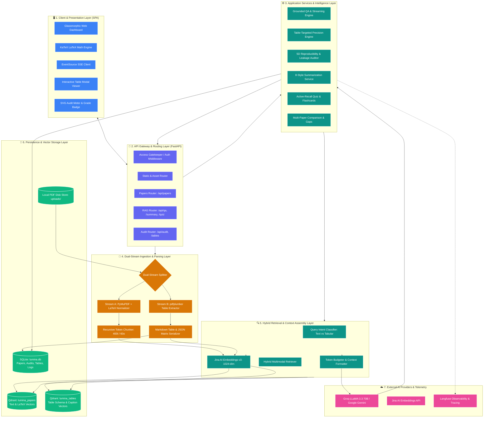
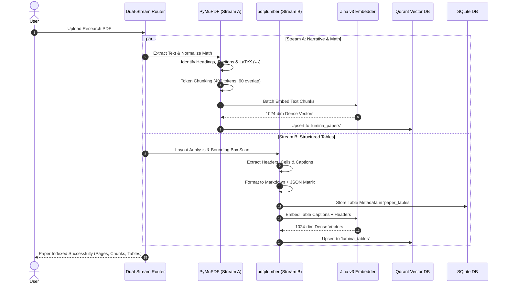
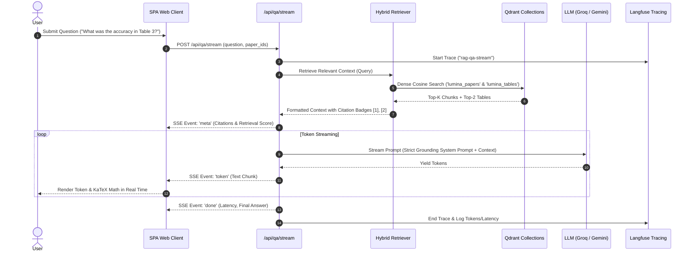

# 🏛️ Lumina AI — Overall System Architecture

> **A Grounded, Zero-Hallucination Scientific Intelligence & Reproducibility Evaluation Engine**  
> *Architectural Specification & End-to-End System Blueprint*

---

## 1. High-Level Multi-Tier Architectural Diagram

---

## 2. Architectural Tiers Breakdown

### Tier 1: Client & Presentation Layer (SPA)
* **Architecture**: Single Page Application (SPA) built with pure ES6+ JavaScript, CSS3 Glassmorphism, and HTML5. Zero bloated JS frameworks for microsecond load times.
* **Key Components**:
  * **Interactive KaTeX Integration**: Real-time rendering of mathematical formulas and equations (`$...$` and `$$...$$`).
  * **Streaming SSE Client**: Listens to `/api/qa/stream` via `EventSource` protocol, incrementally printing tokens while displaying citation metadata pills.
  * **Circular ReproScore Gauge**: Dynamic SVG circular gauge animating the 0–100% reproducibility index and displaying letter grade badges (`A+` to `F`).
  * **Interactive Table Viewer**: Clicking tabular citations (`[Table 1, Page 4]`) launches a modal displaying the exact structured HTML table with row and column highlights.

---

### Tier 2: API Gateway & Routing Layer (FastAPI)
* **FastAPI Framework**: High-performance asynchronous ASGI application with automatic OpenAPI / Swagger generation.
* **Lifespan Management**: Initializes SQLite relational schemas, checks vector database health, and performs auto-fallback between Docker Qdrant and local embedded Qdrant (`data/qdrant`).
* **Routers**:
  1. [`app/routers/papers.py`](file:///d:/LUMINA%20AI/app/routers/papers.py): PDF uploads, URL batch imports, paper metadata listing, deletion, and re-indexing.
  2. [`app/routers/rag.py`](file:///d:/LUMINA%20AI/app/routers/rag.py): Grounded Q&A, streaming SSE, table-targeted Q&A, 8 summary modes, quizzes, flashcards, comparison, and research gaps.
  3. [`app/routers/audit.py`](file:///d:/LUMINA%20AI/app/routers/audit.py): 5-dimensional reproducibility audit, audit refresh, peer-reviewer scorecard export (`.md`), and extracted table inspection.
  4. [`app/auth.py`](file:///d:/LUMINA%20AI/app/auth.py): Optional header-based / cookie-based `ACCESS_CODE` gatekeeper.

---

### Tier 3: Dual-Stream Ingestion & Parsing Pipeline (TeX-RAG)
When a PDF research paper is submitted, it is partitioned through two parallel extraction streams:

1. **Stream A (Text & Equations)**:
   * Uses `PyMuPDF` to parse narrative text while cleaning running headers/footers and fixing hyphenation.
   * LaTeX Normalizer detects inline and display mathematical formulas (Greek characters, math operators, equation numbering) and wraps them in standard LaTeX syntax.
   * `RecursiveChunker` recursively splits on `[\n\n, \n, . , " "]` to construct 400-token chunks with 60-token overlap, retaining page numbers and section headers.
2. **Stream B (Structured Tables)**:
   * Uses `pdfplumber` layout boundary analysis to detect tables, extract column headers, associate vertical captions, and parse cells.
   * Converts tables into Markdown for prompt injection and JSON matrices for coordinate references.

---

### Tier 4: Retrieval & Context Assembly Layer
* **Intent-Aware Routing**: The system classifies incoming queries into:
  * *Narrative Query* (e.g., "What problem does this paper solve?"): Routes to `lumina_papers`.
  * *Empirical / Numeric Query* (e.g., "What was the BLEU score in Table 2?"): Routes to `lumina_tables` + top context chunks.
  * *Reproducibility Audit Query*: Gathers cross-section evidence from both streams.
* **Cosine Similarity Retrieval**: Queries are embedded via Jina AI (`jina-embeddings-v3`) with task-specific adapter parameters, filtered by paper ID, and retrieved with cosine distance thresholds.
* **Context Budgeter**: Packs retrieved chunks and markdown tables into the LLM context window within a strict token budget (`CONTEXT_TOKEN_BUDGET=6000`), prefixing numbered citation anchors `[1]`, `[2]`.

---

### Tier 5: The 5-Dimensional Scientific Reproducibility Auditor
The core engine behind **Novelty 2** audits papers across 5 scientific criteria:

$$\text{ReproScore} = 0.25 \times \text{HCI} + 0.15 \times \text{Compute} + 0.25 \times \text{Data} + 0.20 \times \text{Stats} + 0.15 \times \text{Artifacts}$$

```mermaid
graph LR
    subgraph EvidenceGathering ["1. Evidence Gathering"]
        Q1["HCI Query: lr, optimizer, batch, seeds"]
        Q2["Compute Query: GPUs, hours, cluster"]
        Q3["Data Query: splits, leakage, curation"]
        Q4["Stats Query: variance, p-value, seeds"]
        Q5["Artifacts Query: GitHub, weights, docker"]
    end

    subgraph Evaluator ["2. Evaluation & Synthesis"]
        LLMAuditor["Strict Peer-Reviewer Prompt"]
        JSONParser["Constrained JSON Normalizer"]
        RecipeGen["Reproduction Recipe Synthesizer"]
    end

    subgraph OutputReport ["3. Final Deliverables"]
        ScoreGrade["ReproScore (0-100%) & Grade (A+ to F)"]
        Checklist["Interactive Parameter Checklist"]
        ReviewerDoc["Conference Review Scorecard (.md)"]
    end

    EvidenceGathering --> Evaluator
    Evaluator --> OutputReport
```

* **Reproduction Recipe Synthesis**: Auto-generates hardware requirements (estimated VRAM based on model size/context length), environment dependencies, and runnable CLI execution commands.

---

### Tier 6: Persistence & Storage Layer
1. **SQLite Database (`data/lumina.db`)**:
   * `papers`: Metadata, page counts, chunk counts, upload timestamps, and indexing statuses.
   * `paper_tables`: Structured tables, Markdown strings, and JSON cell matrices.
   * `reproducibility_audits`: Cached 5D audit reports, letter grades, and numerical scores.
   * `summaries`: Cache for 8 summary types to eliminate duplicate LLM generation costs.
   * `qa_logs`: Complete conversation history, citations, and retrieval scores.
   * `activity`: Audit trail of uploads, queries, and system events.
2. **Qdrant Vector Database**:
   * Collection `lumina_papers`: Vectors of text chunks with paper and page metadata.
   * Collection `lumina_tables`: Vectors of table schemas and captions.
   * **Dual Mode**: Runs against a local Docker container (`http://localhost:6333`), Qdrant Cloud, or falls back seamlessly to **local embedded disk storage** (`data/qdrant`) without Docker.
3. **Local File Store (`uploads/`)**:
   * Raw PDF documents stored deterministically by UUID.

---

### Tier 7: Foundation Models & Observability
* **LLM Engine**: Dual support for **Groq** (`llama-3.3-70b-versatile` — ultra-fast inference) and **Google Gemini** (`gemini-flash-lite-latest` — large context reasoning) via unified OpenAI-compatible client abstractions.
* **Embeddings**: **Jina AI v3** (`jina-embeddings-v3`), generating 1024-dimensional semantic embeddings optimized for academic and technical text.
* **Observability (Langfuse Cloud)**: Full distributed tracing logging latency, tokens, retrieval scores, and prompt payloads across all pipeline stages.

---

## 3. End-to-End Query & Grounding Dataflow

---

## 4. Key Architectural Guarantees

1. **Zero-Hallucination Anchor**:
   - The LLM is strictly constrained via system prompts to answer *only* from numbered context snippets. If context is insufficient, it strictly emits: `"I don't know - the uploaded papers do not contain enough information to answer that."`
2. **Dual-Stream Multi-Collection Integrity**:
   - Tabular data is never flattened into unstructured strings; it maintains its 2D semantic grid through Markdown and JSON coordinate matrices.
3. **100% Free-Tier Resiliency**:
   - The entire architecture runs with zero paid infrastructure—utilizing free Groq/Gemini tiers, free Jina embeddings, local/free Qdrant, and free Langfuse Hobby tier.
4. **Offline Testability**:
   - The architecture supports complete deterministic testing using in-memory SQLite and mock vector stores (verified by 28 passing unit and integration tests).
